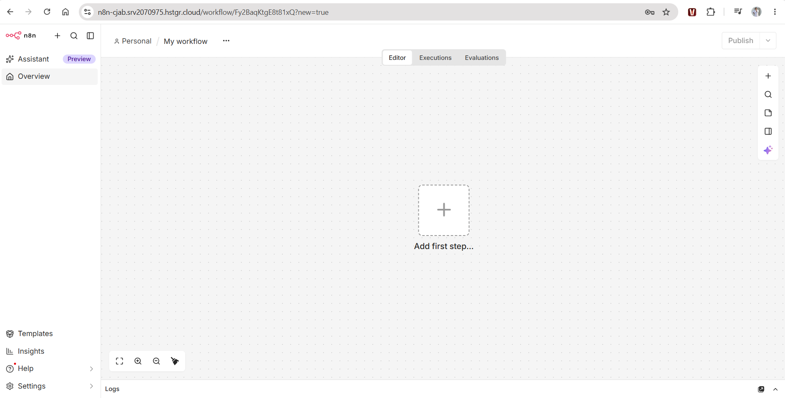

# Self-Hosting n8n with Docker

Notes from setting up a self-hosted n8n workflow automation server with Docker, giving full data control and no execution limits.

> Part of my Gen AI course practice work (Week 3, Day 2).

## Tech stack

- n8n
- Docker

## Features

- Self-hosted n8n instance reachable in the browser
- Screenshot of the running editor

## Getting started

1. Clone the repository:
   ```bash
   git clone https://github.com/Prembazskar/n8n-self-hosting-docker.git
   cd n8n-self-hosting-docker
   ```
2. Install Docker, then follow the official n8n Docker guide: https://docs.n8n.io/hosting/installation/docker/

## Usage

```bash
docker run -it --rm --name n8n -p 5678:5678 -v n8n_data:/home/node/.n8n docker.n8n.io/n8nio/n8n
```

## Screenshots



## License

MIT, see [LICENSE](LICENSE).
